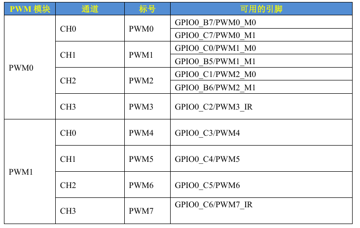
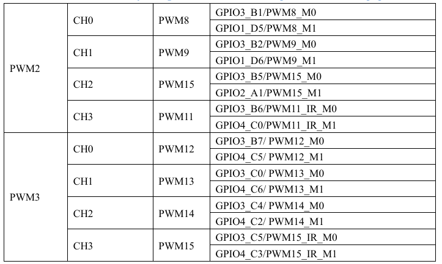

PWM就不过多介绍了，就是方波，有几个关键的指标，频率，也就是开关速度，占空比就是高电平占整个方波周期的比例。而对于PWM有很多应用场景，电机控制，LCD背光亮度调节，巴拉巴拉

## 设备树下PWM控制节点

RK3568有4个PWM模块，每个PWM模块有4个通道，因此一共有16路PWM， PWM0-PWM15。





其中PWM3，PWM7，PWM11和PWM15可用用于IR。专门对于红外线的解调做了硬件优化

## PWM简介

RK3568有4个PWM模块，每个PWM模块的功能基本相同，这些PWM通道的特性如下：

### 1. 通道配置

- 每个 PWM 模块包含 **4 个通道**。

### 2. 捕获模式

- 支持测量输入波形高、低电平的有效周期。
- 输入波形极性发生变化时，可产生中断信号。
- 提供以下寄存器：
  - 32 位高电平捕获寄存器。
  - 32 位低电平捕获寄存器。
  - 32 位当前值寄存器。
- 捕获结果支持保存到 FIFO：
  - FIFO 深度为 8。
  - FIFO 中的数据可通过 CPU 或 DMA 读取。

### 3. PWM 输出模式

- 支持连续模式和单次模式。
- 提供以下寄存器：
  - 32 位周期计数寄存器。
  - 32 位占空比寄存器。
  - 32 位当前值寄存器。
- 支持配置 PWM 输出极性和占空比。
- 支持配置以下对齐模式：
  - 中央对齐模式。
  - 左对齐模式。

## PWM 设备树节点属性

接下来看一下PWM的设备树，RK3568的PWM设备树绑定信息文档为：Documentation/devicetree/bindings/pwm/pwm-rockchip.txt，我们简单总结一下PWM节点信息。

1. compatible

- 必须采用 `rockchip,<name>-pwm` 的形式。
- 示例：
  - `rockchip,rk3288-pwm`
  - `rockchip,rk3568-pwm`
- 对于 RK3568，使用 `rockchip,rk3288-pwm`。

2. reg

- 用于指定 PWM 控制器的物理寄存器基地址。
- 例如，PWM0 的物理寄存器基地址为 `0xFDD70000`。
- 该地址可以在 RK3568 芯片数据手册中查找。

3. clocks

- 用于指定 PWM 控制器使用的时钟源。

4. #pwm-cells

- 用于指定 PWM 控制器的 PWM 参数单元数量。
- 瑞芯微芯片要求该属性的值为 `2` 或 `3`。
- 对于 RK3568，设置为 `3`。

我们可以查看一下rk3568.dtsi 的pwm15的配置

```C
1 pwm15: pwm@fe700030 { 
2         compatible = "rockchip,rk3568-pwm", "rockchip,rk3328-pwm"; 
3         reg = <0x0 0xfe700030 0x0 0x10>; 
4         interrupts = <GIC_SPI 85 IRQ_TYPE_LEVEL_HIGH>, 
5                      <GIC_SPI 89 IRQ_TYPE_LEVEL_HIGH>; 
6         #pwm-cells = <3>; 
7         pinctrl-names = "active"; 
8         pinctrl-0 = <&pwm15m0_pins>; 
9         clocks = <&cru CLK_PWM3>, <&cru PCLK_PWM3>; 
10        clock-names = "pwm", "pclk"; 
11        status = "disabled"; 
12};
```

## PWM子系统

Linux内核提供了个PWM子系统框架，编写PWM驱动的时候一定要符合这个框架。PWM子系统的核心是pwm_chip结构体，定义在文件include/linux/pwm.h中，定义如下：

```C
1  struct pwm_chip { 
2    struct device        *dev; 
3    struct list_head     list; 
4    const struct pwm_ops  *ops; 
5    int            base; 
6    unsigned int         npwm; 
7   
8    struct pwm_device    *pwms; 
9   
10   struct pwm_device * (*of_xlate)(struct pwm_chip *pc, 
11                      const struct of_phandle_args *args); 
12   unsigned int         of_pwm_n_cells; 
13   bool              can_sleep; 
14 };
```

而对于pwm_ops 对应的成员则需要开发人员自行实现

```C
1  struct pwm_ops { 
2    int (*request)(struct pwm_chip *chip, //请求PWM 
3                      struct pwm_device *pwm); 
4    void (*free)(struct pwm_chip *chip,  //释放PWM 
5                   struct pwm_device *pwm); 
6    int (*config)(struct pwm_chip *chip,  //配置PWM周期和占空比 
7                     struct pwm_device *pwm, 
8                     int duty_ns, int period_ns); 
9    int (*set_polarity)(struct pwm_chip *chip, //设置PWM极性 
10                    struct pwm_device *pwm, 
11                    enum pwm_polarity polarity); 
12   int  (*enable)(struct pwm_chip *chip,   //使能PWM 
13                    struct pwm_device *pwm); 
14   void (*disable)(struct pwm_chip *chip,  //关闭PWM 
15                     struct pwm_device *pwm); 
16 #ifdef CONFIG_DEBUG_FS 
17   void (*dbg_show)(struct pwm_chip *chip, 
18                      struct seq_file *s); 
19 #endif 
20   struct module       *owner; 
21 };
```

pwm_ops中的这些函数不一定全部实现，但是像config、enable和disable这些肯定是需要实现的，否则的话打开/关闭PWM，设置PWM的占空比这些就没操作了。

PWM子系统驱动的核心初始化pwm_chip结构体，然后向内核注册初始化完成以后的pwm_chip。这里就要用到pwmchip_add函数，此函数定义在drivers/pwm/core.c文件中，函数原
型如下：

```C
int pwmchip_add(struct pwm_chip  *chip)
```

* chip: 要向内核注册的pwm_chip
* 返回值: 0 成功 ，负数失败

```C
int pwmchip_remove(struct pwm_chip *chip)
```

* chip: 要移除的pwm_chip
* 返回值: 0 成功 ，负数失败
