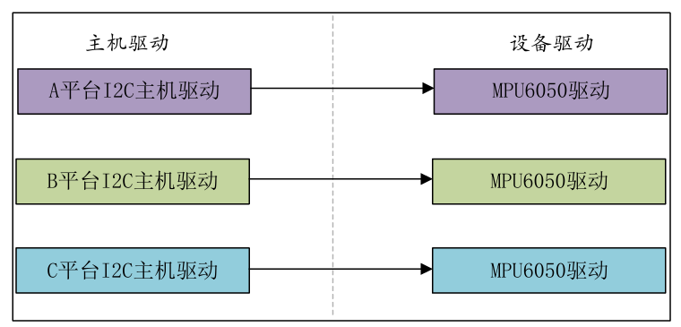
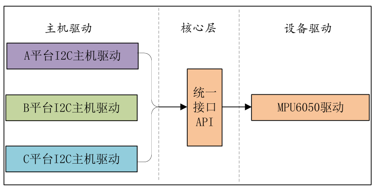
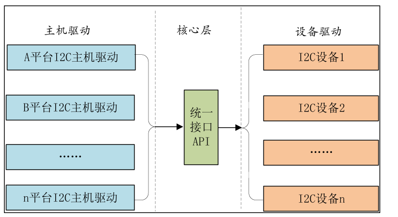

## 简介

当我们在编写驱动的时候，我们通常会面临一个问题，也就是当我们把系统迁移到另外一个硬件平台的时候，驱动需要重新写吗，比如MPU6050，需要每个平台都写一个对应的驱动吗。



当我们拆解一个驱动的时候，我们可以把驱动分为两个层，第一个设备层，第二个协议层，第三个硬件层，当我们迁移到其它平台变得是什么，是硬件层，设备还是那个设备，协议还是那个协议，因此只需要改动硬件层就行了。所以我们需要对驱动进行分层设计，以便于多平台的适配。

那么上面这个方法只是解决了同个设备驱动移植到不同硬件的问题，但是比如说有多个IIC或者SPI驱动的设备，那么设备驱动和主机驱动又要构建一一映射的关系，设备一多，程序就会变得冗杂，因此我们需要一个统一的接口来访问。





而这种管理方式就是是Linux中的总线(bus)、驱动(driver)和设备(device)模型

## platform模型平台

### platform总线

Linux系统内核使用bus_type结构体表示总线，此结构体定义在文件include/linux/device.h，bus_type 结构体内容如下：

```C
struct bus_type {
    /* 总线名称，对应 /sys/bus/<name>，如 "platform"、"i2c"、"spi" */
    const char *name;

    /* 总线上设备的默认命名前缀。设备没有指定名字时，
     * 内核用 "dev_name + id" 命名，如 "cpu" + 0 = cpu0。
     * platform、i2c 这类总线一般不用 */
    const char *dev_name;

    /* 这条总线的"根设备"，是总线上设备默认的父设备，
     * 用于 /sys/devices/system/xxx 这类系统子系统。普通总线基本不用 */
    struct device *dev_root;

    /* 总线自身的默认属性组，创建在 /sys/bus/<name>/ 下
     * （如 drivers_autoprobe、drivers_probe 文件） */
    const struct attribute_group **bus_groups;

    /* 这条总线上每个"设备"的默认属性组，
     * 创建在 /sys/bus/<name>/devices/xxx/ 下（如 modalias、driver_override） */
    const struct attribute_group **dev_groups;

    /* 这条总线上每个"驱动"的默认属性组，
     * 创建在 /sys/bus/<name>/drivers/xxx/ 下 */
    const struct attribute_group **drv_groups;

    /* 【核心】匹配函数。设备或驱动注册时，内核拿一个 device 和一个 driver
     * 调用它，返回非 0 表示匹配，0 表示不匹配。
     * platform 总线里就是 platform_match()：设备树 compatible / id_table / 名字 */
    int (*match)(struct device *dev, struct device_driver *drv);

    /* 产生 uevent 事件时调用，往环境变量里添加总线相关信息
     * （如 MODALIAS=...），udev 据此自动加载对应的驱动模块 */
    int (*uevent)(struct device *dev, struct kobj_uevent_env *env);

    /* 【核心】总线级 probe。匹配成功后内核调用它。
     * 若总线定义了它，先调它，再由它去调 drv->probe；
     * 若没定义，内核直接调 drv->probe */
    int (*probe)(struct device *dev);

    /* 设备移除或驱动卸载时调用，和 probe 相反：释放资源，调用 drv->remove */
    int (*remove)(struct device *dev);

    /* 系统关机/重启时调用，让设备进入安静状态（停 DMA、关中断等） */
    void (*shutdown)(struct device *dev);

    /* 让设备在逻辑上"上线"，用于可热插拔的设备（如 CPU、内存）。
     * 通过 sysfs 的 online 文件触发 */
    int (*online)(struct device *dev);

    /* 让设备在逻辑上"下线"，但不删除设备，和 online 对应 */
    int (*offline)(struct device *dev);

    /* 旧式的总线级挂起回调，已被下面的 pm 取代，新代码不用 */
    int (*suspend)(struct device *dev, pm_message_t state);

    /* 旧式的总线级恢复回调，同上 */
    int (*resume)(struct device *dev);

    /* 返回设备支持/启用的 SR-IOV 虚拟功能（VF）个数，
     * 主要给 PCI 总线用，其他总线一般为 NULL */
    int (*num_vf)(struct device *dev);

    /* probe 之前调用，配置设备的 DMA 参数
     * （DMA 掩码、一致性属性、IOMMU 等）。
     * platform 总线里通常通过设备树或 ACPI 信息完成 */
    int (*dma_configure)(struct device *dev);

    /* 总线级电源管理回调集合：suspend/resume、
     * runtime_suspend/runtime_resume、freeze/thaw 等。
     * 当前主流的电源管理接口，替代上面的 suspend/resume */
    const struct dev_pm_ops *pm;

    /* 这条总线对应的 IOMMU 操作集，用于地址转换与设备隔离。
     * 仅部分总线（如 PCI、platform）关联，较新内核中已调整 */
    const struct iommu_ops *iommu_ops;

    /* 总线私有数据指针，由内核核心在 bus_register() 时分配，
     * 里面存放这条总线的设备链表、驱动链表、kset 等。
     * 总线定义者不要手动赋值，驱动开发者也不要去碰 */
    struct subsys_private *p;

    /* lockdep（内核死锁检测）用的锁类别键，
     * 让这条总线上设备的锁有独立的类别，避免误报死锁 */
    struct lock_class_key lock_key;

    /* 是否需要在 probe/remove 子设备时，先持有父设备的锁。
     * USB 等有层级结构的总线会置 true，防止并发操作父子设备时出问题 */
    bool need_parent_lock;
};
```

platform总线是bus_type的一个具体实例，定义在文件drivers/base/platform.c，platform总
线定义如下：

```C
1   struct bus_type platform_bus_type = { 
2       .name        = "platform", 
3       .dev_groups  = platform_dev_groups, 
4       .match       = platform_match, 
5       .uevent      = platform_uevent, 
6       .dma_configure  = platform_dma_configure, 
7       .pm       = &platform_dev_pm_ops, 
8   };
```

platform_bus_type就是platform平台总线，其中platform_match就是匹配函数。我们来看一下驱动和设备是如何匹配的，platform_match函数定义在文件drivers/base/platform.c中，函数内容如下所示：

```C
static int platform_match(struct device *dev, struct device_driver *drv)
{
    /* 把通用的 struct device 还原成外层的 struct platform_device。
     * 本质是 container_of()：platform_device 里内嵌了一个 struct device dev，
     * 知道内嵌成员的地址，就能算出外层结构体的首地址 */
    struct platform_device *pdev = to_platform_device(dev);

    /* 同理，把通用的 struct device_driver 还原成 struct platform_driver */
    struct platform_driver *pdrv = to_platform_driver(drv);

    /* 第 1 优先级：driver_override（强制绑定）
     * 如果用户通过 sysfs 往该设备的 driver_override 文件写了驱动名，
     * 就只和同名的驱动匹配，其他驱动一律不匹配，也不再走后面的规则。
     * 相等时 strcmp 返回 0，取反得 1，表示匹配 */
    if (pdev->driver_override)
        return !strcmp(pdev->driver_override, drv->name);

    /* 第 2 优先级：设备树（OF）匹配，嵌入式 ARM 平台最常用的方式
     * 拿设备节点的 compatible 属性，去和驱动 of_match_table 里的
     * compatible 逐一比较，有一项对上就返回非 0 */
    if (of_driver_match_device(dev, drv))
        return 1;

    /* 第 3 优先级：ACPI 匹配，主要用于 x86、部分 ARM 服务器。
     * 用 ACPI 表里的设备 ID 与驱动的 acpi_match_table 比较。
     * 用设备树的板子（如 RK3568）基本不会走到这里成功 */
    if (acpi_driver_match_device(dev, drv))
        return 1;

    /* 第 4 优先级：id_table 匹配
     * 驱动提供了 id_table（platform_device_id 数组）时，
     * 拿设备名 pdev->name 和表中每一项的 name 比较。
     * 注意：只要驱动设置了 id_table，这里就直接返回结果，
     * 没找到也返回 0，不会再退回到下面的名字匹配 */
    if (pdrv->id_table)
        return platform_match_id(pdrv->id_table, pdev) != NULL;

    /* 第 5 优先级：名字匹配（兜底）
     * 直接比较设备名和驱动名，相同则匹配。
     * 这是最早期的方式，配合板级文件里手动注册的 platform_device 使用 */
    return (strcmp(pdev->name, drv->name) == 0);
}
```

### platform驱动

platform_driver结构体表示platform驱动，此结构体定义在文件include/linux/platform_device.h中，内容如下：

```C
1  struct platform_driver { 
2    int (*probe)(struct platform_device *); 
3    int (*remove)(struct platform_device *); 
4    void (*shutdown)(struct platform_device *); 
5    int (*suspend)(struct platform_device *, pm_message_t state); 
6     int (*resume)(struct platform_device *); 
7    struct device_driver driver; 
8    const struct platform_device_id *id_table; 
9    bool prevent_deferred_probe; 
10 };
```

id_table是个表(也就是数组)，每个元素的类型为platform_device_id，platform_device_id结构体内容如下：

```C
1 struct platform_device_id { 
2    char name[PLATFORM_NAME_SIZE]; 
3    kernel_ulong_t driver_data; 
4 };
```

device_driver结构体定义在include/linux/device.h，device_driver结构体内容如下：

```C
1  struct device_driver { 
2   const char       *name; 
3   struct bus_type   *bus; 
4   struct module    *owner; 
5   const char       *mod_name;   /* used for built-in modules */ 
6   bool suppress_bind_attrs;     /* disables bind/unbind via sysfs */ 
7   enum probe_type probe_type; 
8   const struct of_device_id   *of_match_table; 
9   const struct acpi_device_id *acpi_match_table; 
10  int (*probe) (struct device *dev); 
11  int (*remove) (struct device *dev); 
12  void (*shutdown) (struct device *dev); 
13  int (*suspend) (struct device *dev, pm_message_t state); 
14  int (*resume) (struct device *dev); 
15  const struct attribute_group **groups; 
16  const struct dev_pm_ops *pm;
17  void (*coredump) (struct device *dev); 
18  struct driver_private *p; 
19 };
```

of_match_table就是采用设备树的时候驱动使用的匹配表，同样是数组，每个匹配
项都为of_device_id结构体类型，此结构体定义在文件include/linux/mod_devicetable.h中，内容
如下：

```C
1 struct of_device_id { 
2   char      name[32]; 
3   char      type[32]; 
4   char      compatible[128]; 
5   const void  *data; 
6 };
```

在编写platform驱动的时候，首先定义一个platform_driver结构体变量，然后实现结构体中的各个成员变量，重点是实现匹配方法以及probe函数。当驱动和设备匹配成功以后probe函数就会执行，具体的驱动程序在probe函数里面编写，比如字符设备驱动等等。

当我们定义并初始化好platform_driver结构体变量以后，需要在驱动入口函数里面调用platform_driver_register函数向Linux内核注册一个platform驱动，platform_driver_register函数
原型如下所示：

```C
int platform_driver_register (struct platform_driver  *driver)
```

* driver：要注册的platform驱动。
* 返回值：负数，失败；0，成功。

还需要在驱动卸载函数中通过platform_driver_unregister函数卸载platform驱动，platform_driver_unregister函数原型如下：

```C
void platform_driver_unregister(struct platform_driver *drv)
```

* drv：要卸载的platform驱动。
* 返回值：无。

### platform设备

platform驱动已经准备好了，我们还需要platform设备，否则的话单单一个驱动也做不了什么。platform_device这个结构体表示platform设备，这里我们要注意，如果内核支持设备树的话就不要再使用platform_device来描述设备了，因为改用设备树去描述了

```C
1  struct platform_device { 
2    const char  *name; 
3    int     id; 
4    bool        id_auto; 
5    struct device   dev; 
6    u32     num_resources; 
7    struct resource *resource; 
8   
9    const struct platform_device_id *id_entry; 
10   char *driver_override; /* Driver name to force a match */ 
11  
12   /* MFD cell pointer */ 
13   struct mfd_cell *mfd_cell; 
14  
15   /* arch specific additions */ 
16   struct pdev_archdata    archdata; 
19 };
```

对于resource结构体，也就是设备信息，比如外设寄存器等

```C
1 struct resource { 
2   resource_size_t start; 
3   resource_size_t end; 
4   const char *name; 
5   unsigned long flags; 
6   unsigned long desc; 
7   struct resource *parent, *sibling, *child; 
8 };
```

start和end分别表示资源的起始和终止信息，对于内存类的资源，就表示内存起始和终止
地址，name表示资源名字，flags表示资源类型，可选的资源类型都定义在了文件
include/linux/ioport.h里面，如下所示：

```C
1   #define IORESOURCE_BITS         0x000000ff  /* Bus-specific bits */ 
2   
3   #define IORESOURCE_TYPE_BITS 0x00001f00  /* Resource type    */ 
4   #define IORESOURCE_IO            0x00000100  /* 表示IO口的资源 */ 
5   #define IORESOURCE_MEM           0x00000200  /* 表示内存地址 */ 
6   #define IORESOURCE_REG            0x00000300  /* Register offsets */ 
7   #define IORESOURCE_IRQ           0x00000400  /* 中断号 */ 
8   #define IORESOURCE_DMA           0x00000800  /* DMA通道号 */ 
9   #define IORESOURCE_BUS           0x00001000   /* 总线号 */ 
...... 
84 #define IORESOURCE_PCI_EA_BEI (1<<5)  /* BAR Equivalent Indicator */
```

在以前不支持设备树的Linux版本中，用户需要编写platform_device变量来描述设备信息，
然后使用platform_device_register函数将设备信息注册到Linux内核中，此函数原型如下所示：

```C
int platform_device_register(struct platform_device *pdev)
```

* pdev：要注册的platform设备。
* 返回值：负数，失败；0，成功。

如果不再使用platform的话可以通过platform_device_unregister函数注销掉相应的platform
设备，platform_device_unregister函数原型如下：

```C
void platform_device_unregister(struct platform_device *pdev)
```

* pdev：要注销的platform设备。
* 返回值：无。

## platform实验

我们使用板载的LED灯进行platform的设备驱动编写实验，由于platform的分层设计，因此我们需要设计两套模块，一个是设备层，一个是驱动层

设备层:

```C
#include <linux/kernel.h>
#include <linux/device.h>
#include <linux/module.h>
#include <linux/platform_device.h>

#define PMU_GRF_BASE (0xFDC20000)
#define PMU_GRF_GPIO0C_IOMUX_L (PMU_GRF_BASE + 0x0010)
#define PMU_GRF_GPIOC_DS_0     (PMU_GRF_BASE + 0X100EC)

#define GPIO0_BASE              (0xFDD60000)
#define GPIO0_SWPORT_DR_H       (GPIO0_BASE + 0X0004)
#define GPIO0_SWPORT_DDR_H      (GPIO0_BASE + 0X000C)
#define REGISTER_LENGTH         (4)

/**
    释放资源
*/
static void led_release(struct device *dev)
{
    printk("led device released \r\n");
}


/**
    声明控制寄存器类型
*/
static struct resource led_resources[] =
{
    [0] = {
        .start = PMU_GRF_GPIO0C_IOMUX_L,
        .end   = (PMU_GRF_GPIO0C_IOMUX_L + REGISTER_LENGTH - 1),
        .flags = IORESOURCE_MEM,
    },
    [1] = {
        .start = PMU_GRF_GPIOC_DS_0,
        .end   = (PMU_GRF_GPIOC_DS_0 + REGISTER_LENGTH - 1),
        .flags = IORESOURCE_MEM,
    },
    [2] = {
        .start = GPIO0_SWPORT_DR_H,
        .end   = (GPIO0_SWPORT_DR_H + REGISTER_LENGTH - 1),
        .flags = IORESOURCE_MEM,
    },
    [3] = {
        .start = GPIO0_SWPORT_DDR_H,
        .end   = (GPIO0_SWPORT_DDR_H + REGISTER_LENGTH - 1),
        .flags = IORESOURCE_MEM,
    },
};

static struct platform_device leddevice = 
{
    .name = "rk3568-platform-led",
    .id   = -1,
    .dev  = {
        .release = &led_release,
    },
    .num_resources = ARRAY_SIZE(led_resources),
    .resource      = led_resources,
};

/**
    模块加载
*/
static int __init led_device_init(void)
{
    return platform_device_register(&leddevice);
}

/**
    模块卸载
*/
static void __exit led_device_exit(void)
{
    platform_device_unregister(&leddevice);
}


module_init(led_device_init);
module_exit(led_device_exit);
MODULE_LICENSE("GPL");
```

在设备层定义了驱动所需要控制的硬件寄存器地址

驱动层

```C
#include <linux/module.h>
#include <linux/kernel.h>
#include <linux/cdev.h>
#include <linux/io.h>
#include <linux/platform_device.h>
#include <linux/resource.h>


#define LED_CNT (1)
#define LEDDEV_NAME ("platformled")
#define LED_OFF (0)
#define LED_ON  (1)

static int led_open(struct inode *inode , struct file *filp);
static ssize_t led_write(struct file *filp, const char __user *buff, size_t cnt, loff_t *loff);

static void __iomem *PMU_GRF_GPIO0C_IOMUX_L_PI;
static void __iomem *PMU_GRF_GPIO0C_DS_0_PI;
static void __iomem *GPIO0_SWPORT_DR_H_PI;
static void __iomem *GPIO0_SWPORT_DDR_H_PI;

struct leddev_dev{
    dev_t devid; // 设备号
    struct cdev cdev;  // 设备类
    struct class *class; // 类
    struct device *device; // 设备
};

struct leddev_dev led_dev;

struct file_operations fp = 
{
    .owner = THIS_MODULE,
    .open = led_open,
    .release = NULL,
    .write = led_write,
};

struct resouces_t
{
    struct resource *ledsource;
    int ressize;
};

void led_switch(uint8_t sta)
{
    uint32_t val = 0;
    if (sta == LED_ON)
    {
        val = readl(GPIO0_SWPORT_DR_H_PI);
        val &= ~(0x01 << 0); 
        val |= ((0x01 << 16) | (0x01 << 0));
        writel(val, GPIO0_SWPORT_DR_H_PI);
    }   
    else if (sta == LED_OFF)
    {
        val = readl(GPIO0_SWPORT_DR_H_PI);
        val &= ~(0x01 << 0); 
        val |= ((0x01 << 16) | (0x00 << 0));
        writel(val, GPIO0_SWPORT_DR_H_PI);
    }
    else
    {
        printk("unknown operation \r\n");
    }
}


/**
    取消地址虚拟映射
*/
void led_unmap(void)
{
    iounmap(GPIO0_SWPORT_DR_H_PI);
    iounmap(PMU_GRF_GPIO0C_DS_0_PI);
    iounmap(GPIO0_SWPORT_DDR_H_PI);
    iounmap(PMU_GRF_GPIO0C_IOMUX_L_PI);
}

static int led_open(struct inode *inode , struct file *filp)
{
    printk("led fp open \r\n");
    return 0;
}

static ssize_t led_write(struct file *filp, const char __user *buff, size_t cnt, loff_t *loff)
{
    int ret = 0;
    uint8_t databuf[1];
    ret = copy_from_user(databuf, buff, cnt);
    if (ret < 0)
    {
        printk("kernel write failed \r\n");
        return -EFAULT;
    }

    if (databuf[0] == LED_ON)
    {
        led_switch(LED_ON);
    }
    else if (databuf[0] == LED_OFF)
    {
        led_switch(LED_OFF);
    }
    return cnt;
}

static int led_probe(struct platform_device *dev)
{
    struct resouces_t ledsource[4];
    uint8_t i = 0;
    int ret = 0;
    uint32_t val = 0;
    printk("led driver and device matched \r\n");
    for (i = 0;i < 4; ++i)
    {
        ledsource[i].ledsource = platform_get_resource(dev, IORESOURCE_MEM, i);
        // 空指针
        if (!ledsource[i].ledsource)
        {
            dev_err(&dev->dev, "No MEM resource for always on \r\n");
            return -ENXIO;
        }
        ledsource[i].ressize = resource_size(ledsource[i].ledsource);
    }

    PMU_GRF_GPIO0C_IOMUX_L_PI = ioremap(ledsource[0].ledsource->start, ledsource[0].ressize);
    PMU_GRF_GPIO0C_DS_0_PI    = ioremap(ledsource[1].ledsource->start, ledsource[1].ressize);
    GPIO0_SWPORT_DR_H_PI      = ioremap(ledsource[2].ledsource->start, ledsource[2].ressize);
    GPIO0_SWPORT_DDR_H_PI     = ioremap(ledsource[3].ledsource->start, ledsource[3].ressize);

    // 设置GPIO复用功能
    val = readl(PMU_GRF_GPIO0C_IOMUX_L_PI);
    val &= ~(0X7 << 0);
    val |= ((0X7 << 16) | (0X0 << 0));
    writel(val, PMU_GRF_GPIO0C_IOMUX_L_PI);

    // 设置输出能力
    val = readl(PMU_GRF_GPIO0C_DS_0_PI);
    val &= ~(0X3F << 0);
    val |= ((0X3F << 16) | (0X3F << 0)); 
    writel(val, PMU_GRF_GPIO0C_DS_0_PI);

    // 设置输入输出
    val = readl(GPIO0_SWPORT_DDR_H_PI);
    val &= ~(0X1 << 0);
    val |= ((0X1 << 16) | (0X1 << 0)); 
    writel(val, GPIO0_SWPORT_DDR_H_PI);

    // 设置默认电平
    val = readl(GPIO0_SWPORT_DR_H_PI); 
    val &= ~(0X1 << 0);
    val |= ((0X1 << 16) | (0X0 << 0));
    writel(val, GPIO0_SWPORT_DR_H_PI); 

    // 注册字符设备驱动
  
    // 申请设备号
    ret = alloc_chrdev_region(&led_dev.devid, 0, LED_CNT, LEDDEV_NAME);
    if (ret < 0)
    {
        printk("alloc dev num fail \r\n");
        goto alloc_dev_fail;
    }
    // 注册字符设备
    led_dev.cdev.owner = THIS_MODULE;
    cdev_init(&led_dev.cdev,  &fp); 

    // 添加字符设备到散列表
    ret = cdev_add(&led_dev.cdev, led_dev.devid, LED_CNT);
    if(ret < 0)
    {
        printk("add cdev err \r\n");
        goto add_dev_err;
    }
    // 申请一个类
    led_dev.class = class_create(THIS_MODULE, LEDDEV_NAME);
    if (IS_ERR(led_dev.class))
    {
        printk("create class err \r\n");
        goto class_err;
    }

    led_dev.device = device_create(led_dev.class, NULL, led_dev.devid, NULL, LEDDEV_NAME);
    if (IS_ERR(led_dev.device))
    {
        printk("device create failed \r\n");
        goto device_err;
    }
    return 0;
device_err:
    class_destroy(led_dev.class);
class_err:
add_dev_err:
    unregister_chrdev_region(led_dev.devid, LED_CNT);
    cdev_del(&led_dev.cdev);
alloc_dev_fail:
    led_unmap();
    return 0;
}

static int led_remove(struct platform_device *dev)
{
    led_unmap();
    device_destroy(led_dev.class, led_dev.devid);
    class_destroy(led_dev.class);
    unregister_chrdev_region(led_dev.devid, LED_CNT);
    cdev_del(&led_dev.cdev);
    printk("led removed \r\n");
    return 0;
}

static struct platform_driver led_driver = 
{
    .driver = 
    {
        .name  = "rk3568-platform-led"
    },
    .probe = led_probe,
    .remove = led_remove, 
};

static int __init led_driver_init(void)
{
    return platform_driver_register(&led_driver);
}

static void __exit led_driver_exit(void)
{
    printk("led driver exit \r\n");
    platform_driver_unregister(&led_driver);
}

module_init(led_driver_init);
module_exit(led_driver_exit);
MODULE_LICENSE("GPL");
```

在驱动层则会读取设备层的操控的GPIO的寄存器地址，以达到控制LED灯亮灭的目的。实际在项目编写的过程中，对于设备层只需要配置对应的设备树即可，因为设备层由半导体原厂已经编写封装好了，这是下一章要讲的内容。

然后就是编写测试程序由GPT进行编写，效果仍然为一秒钟闪烁一次

```C
#include <errno.h>
#include <fcntl.h>
#include <stdio.h>
#include <unistd.h>

#define LED_OFF 0
#define LED_ON  1

int main(int argc, char *argv[])
{
    const char *dev_path = argc > 1 ? argv[1] : "/dev/platformled";
    int fd = open(dev_path, O_WRONLY);
    unsigned char value;

    if (fd < 0) {
        perror("open");
        return 1;
    }

    printf("LED test started on %s (Ctrl+C to stop)\n", dev_path);
    for (;;) {
        value = LED_ON;
        if (write(fd, &value, sizeof(value)) != sizeof(value)) {
            perror("write LED_ON");
            close(fd);
            return 1;
        }
        sleep(1);

        value = LED_OFF;
        if (write(fd, &value, sizeof(value)) != sizeof(value)) {
            perror("write LED_OFF");
            close(fd);
            return 1;
        }
        sleep(1);
    }
}
```

最后的终端运行结果为

```Shell
root@ATK-DLRK3568:/lib/modules# ls
5.10.160           led_atomic_module.ko     led_spin_lock_module.ko
8852be.ko          led_device.ko            parameter.ko
8852bs.ko          led_driver.ko            rtk_btusb.ko
bcmdhd.ko          led_driver_module.ko     rtkm.ko
bcmdhd_pcie.ko     led_dts_gpio_module.ko   RTL8189FS.ko
calculate.ko       led_dts_module.ko        RTL8189FU.ko
chardev_module.ko  led_dts_timer_module.ko  RTL8723DS.ko
hci_uart.ko        led_mutex_module.ko      RTL8821CS.ko
hello.ko           led_semaphore_module.ko  RTL8822CS.ko
root@ATK-DLRK3568:/lib/modules# inmod led_driver.ko
sh: inmod: command not found
root@ATK-DLRK3568:/lib/modules# insmod led_driver.ko
[ 1072.717008] led driver and device matched
root@ATK-DLRK3568:/lib/modules# cd /home/ftp/
root@ATK-DLRK3568:/home/ftp# ./led_platform_test_app /dev/platformled
[ 1078.285996] led fp open
LED test started on /dev/platformled (Ctrl+C to stop)
```

实际效果就是板载LED灯 以一秒钟为周期进行闪烁


## 总结

采用 platform 框架编写驱动，可以将驱动代码与板级硬件信息分离，从而提高驱动的可移植性和复用性，并减少内核中因板级差异产生的重复代码。本章介绍的是不依赖设备树的传统方式，即在板级代码中以 C 语言静态注册 `platform_device`。由于目前常用的内核版本普遍支持设备树，设备树方式将在下一章重点讲解。

platform 框架由设备、驱动和总线三部分组成：

* **设备** （`platform_device`）：描述硬件资源，如寄存器地址范围、中断号、时钟等，只提供数据，不包含操作硬件的逻辑。
* **驱动** （`platform_driver`）：实现对某一类硬件的操作逻辑，如硬件初始化、寄存器读写、中断处理，并将获取的数据上报给上层子系统。
* **总线** （`platform_bus_type`）：维护设备链表和驱动链表，通过 `match` 回调判断二者是否匹配。匹配成功后调用驱动的 `probe` 函数，并把设备信息传递给驱动，完成绑定。
