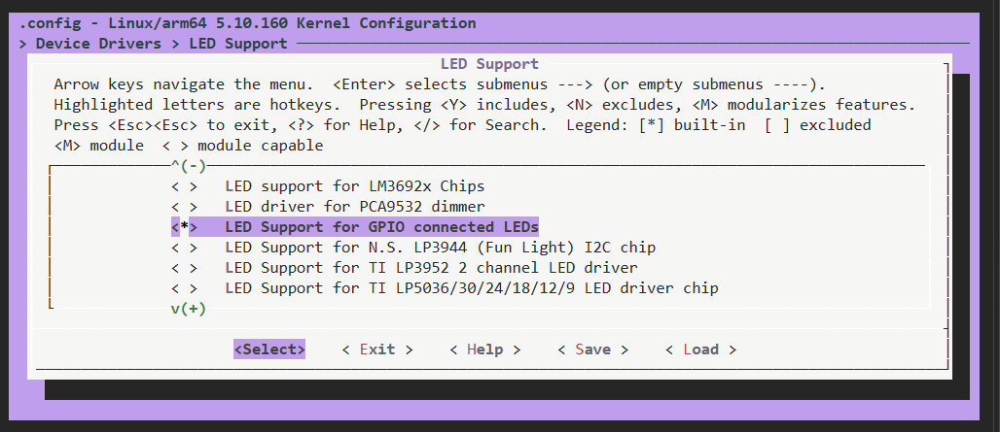

由于像LED驱动这种简单的驱动程序，其实在linux内核当中已经自带了LED灯的驱动

## 驱动使能

要使用内核自带的LED灯驱动需要配置Linux内核，使能LED灯驱动



## LED驱动框架分析

led灯的驱动文件为/drivers/leds/leds-gpio.c，可以通过/drivers/leds/Makefile 看到

```CMake
# SPDX-License-Identifier: GPL-2.0

# LED Core
obj-$(CONFIG_NEW_LEDS)			+= led-core.o
obj-$(CONFIG_LEDS_CLASS)		+= led-class.o
obj-$(CONFIG_LEDS_CLASS_FLASH)		+= led-class-flash.o
obj-$(CONFIG_LEDS_CLASS_MULTICOLOR)	+= led-class-multicolor.o
obj-$(CONFIG_LEDS_TRIGGERS)		+= led-triggers.o

# LED Platform Drivers (keep this sorted, M-| sort)
obj-$(CONFIG_LEDS_88PM860X)		+= leds-88pm860x.o
obj-$(CONFIG_LEDS_AAT1290)		+= leds-aat1290.o
obj-$(CONFIG_LEDS_ACER_A500)		+= leds-acer-a500.o
obj-$(CONFIG_LEDS_ADP5520)		+= leds-adp5520.o
obj-$(CONFIG_LEDS_AN30259A)		+= leds-an30259a.o
obj-$(CONFIG_LEDS_APU)			+= leds-apu.o
obj-$(CONFIG_LEDS_ARIEL)		+= leds-ariel.o
obj-$(CONFIG_LEDS_AS3645A)		+= leds-as3645a.o
obj-$(CONFIG_LEDS_ASIC3)		+= leds-asic3.o
obj-$(CONFIG_LEDS_AW2013)		+= leds-aw2013.o
obj-$(CONFIG_LEDS_BCM6328)		+= leds-bcm6328.o
obj-$(CONFIG_LEDS_BCM6358)		+= leds-bcm6358.o
obj-$(CONFIG_LEDS_BD2802)		+= leds-bd2802.o
obj-$(CONFIG_LEDS_BLINKM)		+= leds-blinkm.o
.......
```

当定义了某个参数，就会编译对应的led的驱动文件在上一小
节我们选择将LED驱动编译进Linux内核，在.config文件中就会有“CONFIG_LEDS_GPIO=y”这一行，因此leds-gpio.c驱动文件就会被编译。

	我们可以看leds-gpio.c这个驱动文件

```C
215 static const struct of_device_id of_gpio_leds_match[] = { 
216     { .compatible = "gpio-leds", }, 
217     {}, 
218 }; 
219  
220 MODULE_DEVICE_TABLE(of, of_gpio_leds_match); 
...... 
267 static struct platform_driver gpio_led_driver = { 
268     .probe      = gpio_led_probe, 
269     .shutdown   = gpio_led_shutdown, 
270     .driver     = { 
271         .name   = "leds-gpio", 
272         .of_match_table = of_gpio_leds_match, 
273     }, 
274 }; 
275  
276 module_platform_driver(gpio_led_driver);
```

在led驱动的匹配表只有一个匹配项，也就是 "gpio-leds", 因此LED灯设备节点的compatible属性值也要为"gpio-leds", 否则就无法匹配成功。而在这个驱动当中同样也使用了platform框架。

## module_platform_driver函数解析

在上一小节中我们知道LED驱动会采用module_platform_driver函数向Linux内核注册platform驱动，其实在Linux内核中会大量采用module_platform_driver来完成向Linux内核注册platform驱动的操作。

```C
1 #define module_platform_driver(__platform_driver) \ 
2     module_driver(__platform_driver, platform_driver_register, \ 
3             platform_driver_unregister) 
```

可以看出，module_platform_driver依赖module_driver，module_driver也是一个宏，定义在include/linux/device.h文件中，内容如下：

```C
1  #define module_driver(__driver, __register, __unregister, ...) \ 
2  static int __init __driver##_init(void) \ 
3  { \ 
4   return __register(&(__driver) , ##__VA_ARGS__); \ 
5  } \ 
6  module_init(__driver##_init); \ 
7  static void __exit __driver##_exit(void) \ 
8  { \ 
9   __unregister(&(__driver) , ##__VA_ARGS__); \ 
10 } \ 
11 module_exit(__driver##_exit); 
```

因此使用platform框架就不需要再编写init以及exit的函数。

## gpio_led_probe解析

当驱动和设备匹配以后gpio_led_probe函数就会执行，此函数主要是从设备树中获取LED灯的GPIO信息，缩减后的函数内容如下所示：

```C
1  static int gpio_led_probe(struct platform_device *pdev) 
2  { 
3   struct gpio_led_platform_data *pdata = dev_get_platdata(&pdev->dev); 
4   struct gpio_leds_priv *priv; 
5   int i, ret = 0; 
6   
7   if (pdata && pdata->num_leds) {  /* 非设备树方式      */ 
...... /* 获取platform_device信息 */ 
21      } 
22  } else {                            /* 采用设备树          */ 
23      priv = gpio_leds_create(pdev); 
24      if (IS_ERR(priv)) 
25          return PTR_ERR(priv); 
26  } 
27  
28  platform_set_drvdata(pdev, priv); 
29  
30  return 0; 
31 }
```

如果使用设备树的话，使用gpio_leds_create函数从设备树中提取设备信息，获取到的LED灯GPIO信息保存在返回值中，gpio_leds_create函数内容如下：

```C
/*
 * 作用：解析设备树中 gpio-leds 节点下的每一个子节点（每个子节点描述一个LED），
 *       为每个LED申请GPIO、读取属性、注册成LED类设备，最后把所有LED的信息
 *       汇总到一个 gpio_leds_priv 结构体中返回。
 * 参数：pdev —— 与设备树节点匹配成功后，内核创建的 platform_device
 * 返回：成功返回 priv 指针；失败返回用 ERR_PTR() 编码过的错误码指针，
 *       调用者（gpio_led_probe）用 IS_ERR()/PTR_ERR() 判断和取出错误码
 */
static struct gpio_leds_priv *gpio_leds_create(struct platform_device *pdev)
{
	/*
	 * platform_device 内部嵌有一个通用的 struct device，
	 * 内核里大部分通用接口（设备树属性读取、devm_ 资源管理等）都以 struct device 为参数，
	 * 所以先取出它的地址，后面反复使用
	 */
	struct device *dev = &pdev->dev;
	/*
	 * fwnode_handle 是“固件节点”的统一句柄。
	 * 固件描述硬件的方式不止设备树一种（还有ACPI），内核用 fwnode 把它们抽象成同一套接口，
	 * 在使用设备树的平台上，一个 fwnode 实际就对应设备树里的一个节点
	 */
	struct fwnode_handle *child;
	/* 驱动的私有数据，保存所有LED的信息，最终作为返回值 */
	struct gpio_leds_priv *priv;
	int count, ret;

	/*
	 * 获取当前设备节点下子节点的个数。
	 * 设备树中 gpio-leds 节点的写法一般是：
	 *   leds {
	 *       compatible = "gpio-leds";
	 *       led0 { gpios = <&gpio1 3 GPIO_ACTIVE_LOW>; ... };
	 *       led1 { ... };
	 *   };
	 * 每个子节点就是一个LED，所以 count 就是LED的数量
	 */
	count = device_get_child_node_count(dev);
	/* 一个子节点都没有，说明设备树里没有描述任何LED，返回“设备不存在”错误 */
	if (!count)
		return ERR_PTR(-ENODEV);

	/*
	 * 为私有数据分配内存。
	 * gpio_leds_priv 的定义为：
	 *   struct gpio_leds_priv {
	 *       int num_leds;                  // 已成功注册的LED个数
	 *       struct gpio_led_data leds[];   // 柔性数组，长度运行时才确定
	 *   };
	 * struct_size(priv, leds, count) 计算的是
	 *   sizeof(*priv) + count * sizeof(priv->leds[0])
	 * 即结构体头部 + count 个LED数据的总大小，并且内部做了乘法溢出检查。
	 *
	 * devm_kzalloc：
	 *   - kzalloc 表示分配内核内存并清零（所以 num_leds 初始为0）
	 *   - devm_ 前缀表示这块内存与 dev 绑定，驱动卸载或 probe 失败时内核会自动释放，
	 *     不需要手动 kfree
	 * GFP_KERNEL：常规的内核内存分配标志，允许在内存不足时睡眠等待
	 */
	priv = devm_kzalloc(dev, struct_size(priv, leds, count), GFP_KERNEL);
	/* 分配失败，返回“内存不足”错误 */
	if (!priv)
		return ERR_PTR(-ENOMEM);

	/*
	 * 遍历当前节点的所有子节点，每次循环 child 指向一个子节点（一个LED）。
	 * 注意：这个宏在遍历过程中会自动增加/减少 child 的引用计数，
	 * 正常走完循环不需要额外处理；但如果中途 return 跳出循环，
	 * 必须手动调用 fwnode_handle_put(child) 释放当前 child 的引用，否则会引用计数泄漏
	 */
	device_for_each_child_node(dev, child) {
		/*
		 * 取出 priv->leds 数组中下一个空位的地址。
		 * num_leds 每成功注册一个LED才加1，所以它同时也是“下一个待填位置”的下标
		 */
		struct gpio_led_data *led_dat = &priv->leds[priv->num_leds];
		/*
		 * 临时结构体，用来暂存从设备树读出的配置（GPIO、默认状态等），
		 * 稍后交给 create_gpio_led() 使用。= {} 表示所有成员初始化为0
		 */
		struct gpio_led led = {};
		/* 用于接收 default-state 属性的字符串值 */
		const char *state = NULL;

		/*
		 * Acquire gpiod from DT with uninitialized label, which
		 * will be updated after LED class device is registered,
		 * Only then the final LED name is known.
		 * （从设备树获取GPIO描述符，此时先不设置标签名，
		 *   因为LED的最终名字要等LED类设备注册之后才能确定，届时再更新标签）
		 */
		/*
		 * 从子节点中获取 GPIO，返回一个 gpio_desc 描述符（gpiod）。
		 * 参数依次为：
		 *   dev        —— 所属设备，devm_ 版本会在设备卸载时自动释放该GPIO
		 *   NULL       —— 属性名前缀，NULL 表示读取名为 "gpios" 的属性
		 *                 （若传 "led" 则读取 "led-gpios"）
		 *   child      —— 要读取的子节点
		 *   GPIOD_ASIS —— 获取GPIO时不改变它的方向和电平，保持原样
		 *                 （方向和初始电平稍后根据 default-state 决定）
		 *   NULL       —— GPIO的标签名，暂时为空，原因见上方注释
		 *
		 * 设备树中 GPIO_ACTIVE_LOW 这类有效电平标志也会记录在 gpiod 中，
		 * 之后用 gpiod_set_value(gpiod, 1) 表示“点亮”，由 gpiolib 自动处理电平翻转
		 */
		led.gpiod = devm_fwnode_get_gpiod_from_child(dev, NULL, child,
							     GPIOD_ASIS,
							     NULL);
		/*
		 * 获取失败（比如子节点没写 gpios 属性，或GPIO控制器驱动还没加载）。
		 * 内核中很多函数返回指针时，会把错误码编码进指针里返回，
		 * 用 IS_ERR() 判断是否为错误指针
		 */
		if (IS_ERR(led.gpiod)) {
			/* 中途退出循环，手动释放当前子节点的引用 */
			fwnode_handle_put(child);
			/*
			 * ERR_CAST：把一种类型的错误指针转换成另一种类型的错误指针，
			 * 错误码不变。这里从 gpio_desc* 转成本函数的返回类型 gpio_leds_priv*
			 */
			return ERR_CAST(led.gpiod);
		}

		/* 把获取到的GPIO描述符保存到最终的LED数据中 */
		led_dat->gpiod = led.gpiod;

		/*
		 * 读取子节点的 "default-state" 属性，决定LED在驱动加载时的初始状态。
		 * fwnode_property_read_string 成功返回0，所以这里用 ! 取反判断“读取成功”。
		 * 如果设备树里没写这个属性，则跳过，default_state 保持初始值0
		 * （即 LEDS_GPIO_DEFSTATE_OFF，默认熄灭）
		 */
		if (!fwnode_property_read_string(child, "default-state",
						 &state)) {
			/* strcmp 两字符串相等时返回0，所以 !strcmp 表示“相等” */
			if (!strcmp(state, "keep"))
				/* "keep"：保持GPIO当前的电平不变（例如bootloader已经点亮了它） */
				led.default_state = LEDS_GPIO_DEFSTATE_KEEP;
			else if (!strcmp(state, "on"))
				/* "on"：驱动加载时点亮 */
				led.default_state = LEDS_GPIO_DEFSTATE_ON;
			else
				/* 其他值（包括 "off"）：驱动加载时熄灭 */
				led.default_state = LEDS_GPIO_DEFSTATE_OFF;
		}

		/*
		 * 下面三个属性都是“布尔属性”：设备树中只要写了属性名（不需要赋值）就表示开启。
		 * fwnode_property_present 只判断属性是否存在
		 */
		/* retain-state-suspended：系统休眠(suspend)时保持LED当前状态，不自动熄灭 */
		if (fwnode_property_present(child, "retain-state-suspended"))
			led.retain_state_suspended = 1;
		/* retain-state-shutdown：系统关机时保持LED当前状态，不自动熄灭 */
		if (fwnode_property_present(child, "retain-state-shutdown"))
			led.retain_state_shutdown = 1;
		/* panic-indicator：内核崩溃(panic)时，用这个LED指示故障（通常会闪烁） */
		if (fwnode_property_present(child, "panic-indicator"))
			led.panic_indicator = 1;

		/*
		 * 根据上面收集到的配置，真正创建一个LED：
		 *   - 设置GPIO方向为输出，并按 default_state 设置初始电平
		 *   - 填充 led_dat 中的 cdev（struct led_classdev，LED类设备）
		 *   - 把它注册到LED子系统，注册成功后会出现 /sys/class/leds/<名字>/ 目录，
		 *     用户空间可以通过 brightness、trigger 等文件控制LED
		 * LED的名字从子节点的 label 属性或节点名中获取，所以这里要传入 child
		 */
		ret = create_gpio_led(&led, led_dat, dev, child, NULL);
		/* 创建失败，同样要先释放子节点引用再返回错误 */
		if (ret < 0) {
			fwnode_handle_put(child);
			return ERR_PTR(ret);
		}
		/* Set gpiod label to match the corresponding LED name. */
		/*
		 * 此时LED类设备已经注册完成，名字已确定（保存在 cdev.dev->kobj.name 中），
		 * 把这个名字设置为GPIO的使用者标签。
		 * 这样在 /sys/kernel/debug/gpio 中查看GPIO占用情况时，
		 * 能直接看出这个GPIO被哪个LED使用
		 */
		gpiod_set_consumer_name(led_dat->gpiod,
					led_dat->cdev.dev->kobj.name);
		/* 当前LED处理完毕，计数加1，下一轮循环将使用数组的下一个位置 */
		priv->num_leds++;
	}

	/*
	 * 所有LED处理完毕，返回私有数据。
	 * gpio_led_probe 会通过 platform_set_drvdata(pdev, priv) 把它保存到设备中，
	 * 以便在 shutdown 等其他回调函数中再取出使用
	 */
	return priv;
}
```

## 设备树深度理解

在此机会继续加深一下对于设备树的理解，其实设备树的层级，可以直接看作为烧录到系统的文件层级，我们可以清楚的知道，在这个子节点下，有多少个孙节点，比如说SPI设备，会有SPI1，SPI2巴拉巴拉。而对于孙节点前面会有个标签

```C
  work_led: work {
      gpios = <&gpio0 RK_PC0 GPIO_ACTIVE_HIGH>;
      linux,default-trigger = "heartbeat";
      status = "okay";
  };
```

也就是work前面的work_led，而就标签是节点的名字,让其他地方能快捷地引用或修改这个节点。
