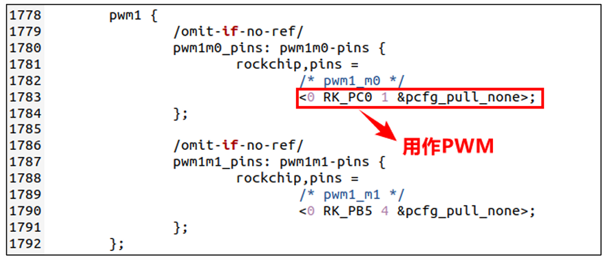
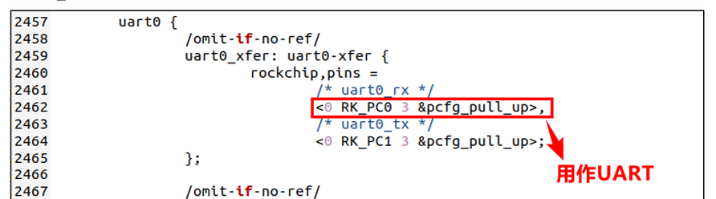

对于支持设备树的操作系统，最常见的驱动开发方式就是platform加上设备树的方式，因为厂家会提供原厂的SDK。在使用设备树的时候，设备的描述被放到了设备树中，因此platform_device就不需要我们去编写了，我们只需要实现platform_driver即可。

## 创建设备pinctrl节点

在platform 驱动框架下必须使用pinctrl来配置引脚复用功能。我们以本章实验需要用到的LED0 为例，编写LED0引脚的 pinctrl 配置。打开rk3568-pinctrl.dtsi 文件，RK3568 的所有引脚pinctrl 配置都是在这个文件里面完成的，在pinctrl节点下添加如下所示内容：

```C
led-gpios{
    led-gpio: led-pin{
        rockchip, pin = <0 RK_PC0 RK_FUNC_GPIO &pcfg_pull_none>;
    };	
};
```

并在根节点下修改设备驱动，绑定pinctrl

```C
gpio_led {
    compatible = "alientek, led";
    pinctrl-names = "alientek, led"; // pinctrl 配置
    led-gpio = <&gpio0 RK_PC0 GPIO_ACTIVE_HIGH>;
    status = "okay";
};
```

## 修改驱动

由于我们创建了pinctrl节点，因此我们需要为驱动创建一个兼容表，用于进行匹配

```C
// 匹配表
static const struct of_device_id led_of_match[] = 
{
    {.compatible = "alientek, led"},
    {/*..todo*/}
};

static struct platform_driver led_driver = 
{
    .driver = 
    {
        .name  = "rk3568-platform-led",
        .of_match_table = led_of_match,
    },
    .probe = led_probe,
    .remove = led_remove, 
};
```

## 检查引脚复用配置

RK3568当中一个引脚可以复用为多种功能，比如GPIO0_C0引脚可以用作PWM，GPU_AVS, UART_RX，GPIO四个功能。与单片机开发相似，当一个引脚被用于其中一种功能，就不能作为其他的功能

比如在rk3568-pinctrl里





同时还需要检查是否GPIO被占用

## 驱动代码编写

对于驱动代码的编写只需要改为前几章节提及的pinctrl以及设备树的写法就行了，获取node节点以及compatible，然后与匹配表进行匹配，匹配后，获取控制引脚，就可以使用pinctrl的方式进行控制

```C
#include <linux/module.h>
#include <linux/kernel.h>
#include <linux/cdev.h>
#include <linux/io.h>
#include <linux/platform_device.h>
#include <linux/resource.h>
#include <linux/of_device.h>
#include <linux/device.h>
#include <linux/gpio.h>
#include <linux/of_gpio.h>

#define LED_CNT (1)
#define LEDDEV_NAME ("dtsplatformled")
#define LED_OFF (0)
#define LED_ON  (1)

static int led_open(struct inode *inode , struct file *filp);
static ssize_t led_write(struct file *filp, const char __user *buff, size_t cnt, loff_t *loff);

struct leddev_dev{
    dev_t devid; // 设备号
    struct cdev cdev;  // 设备类
    struct class *class; // 类
    struct device *device; // 设备
    int gpio_led;   // gpio 号
};

struct leddev_dev led_dev;

struct file_operations fp = 
{
    .owner = THIS_MODULE,
    .open = led_open,
    .release = NULL,
    .write = led_write,
};

struct resouces_t
{
    struct resource *ledsource;
    int ressize;
};

void led_switch(uint8_t sta)
{
    if (sta == LED_ON || sta == LED_OFF) 
    {
        gpio_set_value(led_dev.gpio_led, sta);
    }   
    else
    {
        printk("unknown operation \r\n");
    }
}


static int led_open(struct inode *inode , struct file *filp)
{
    printk("led fp open \r\n");
    return 0;
}

static ssize_t led_write(struct file *filp, const char __user *buff, size_t cnt, loff_t *loff)
{
    int ret = 0;
    uint8_t databuf[1];
    ret = copy_from_user(databuf, buff, cnt);
    if (ret < 0)
    {
        printk("kernel write failed \r\n");
        return -EFAULT;
    }

    if (databuf[0] == LED_ON)
    {
        led_switch(LED_ON);
    }
    else if (databuf[0] == LED_OFF)
    {
        led_switch(LED_OFF);
    }
    return cnt;
}

static int led_gpio_init(struct device_node *nd)
{
    int ret = 0;
    led_dev.gpio_led = of_get_named_gpio(nd, "led-gpio", 0);
    if (!gpio_is_valid(led_dev.gpio_led))
    {
        printk(KERN_ERR"leddev: failed to get led-gpio \r\n");
        return -EINVAL;
    }

    ret = gpio_request(led_dev.gpio_led, "LED");
    if (ret)
    {
        printk(KERN_ERR"led: failed to reuqest \r\n");
        return ret;
    }
    gpio_direction_output(led_dev.gpio_led, 0);
    return 0;
}

static int led_probe(struct platform_device *dev)
{
    int ret = 0;
    printk("led driver and device matched \r\n");
    ret = led_gpio_init(dev->dev.of_node);
    if (ret < 0)
    {
        return ret;
    }

    // 注册字符设备驱动
  
    // 申请设备号
    ret = alloc_chrdev_region(&led_dev.devid, 0, LED_CNT, LEDDEV_NAME);
    if (ret < 0)
    {
        printk("alloc dev num fail \r\n");
        goto alloc_dev_fail;
    }
    // 注册字符设备
    led_dev.cdev.owner = THIS_MODULE;
    cdev_init(&led_dev.cdev,  &fp); 

    // 添加字符设备到散列表
    ret = cdev_add(&led_dev.cdev, led_dev.devid, LED_CNT);
    if(ret < 0)
    {
        printk("add cdev err \r\n");
        goto add_dev_err;
    }
    // 申请一个类
    led_dev.class = class_create(THIS_MODULE, LEDDEV_NAME);
    if (IS_ERR(led_dev.class))
    {
        printk("create class err \r\n");
        goto class_err;
    }

    led_dev.device = device_create(led_dev.class, NULL, led_dev.devid, NULL, LEDDEV_NAME);
    if (IS_ERR(led_dev.device))
    {
        printk("device create failed \r\n");
        goto device_err;
    }
    return 0;
device_err:
    class_destroy(led_dev.class);
class_err:
add_dev_err:
    unregister_chrdev_region(led_dev.devid, LED_CNT);
    cdev_del(&led_dev.cdev);
alloc_dev_fail:
    gpio_free(led_dev.gpio_led);
    return 0;
}

static int led_remove(struct platform_device *dev)
{
    gpio_set_value(led_dev.gpio_led, 0);
    gpio_free(led_dev.gpio_led);
    device_destroy(led_dev.class, led_dev.devid);
    class_destroy(led_dev.class);
    unregister_chrdev_region(led_dev.devid, LED_CNT);
    cdev_del(&led_dev.cdev);
    printk("led removed \r\n");
    return 0;
}


// 匹配表
static const struct of_device_id led_of_match[] = 
{
    {.compatible = "alientek, led"},
    {/*..todo*/}
};

static struct platform_driver led_driver = 
{
    .driver = 
    {
        .name  = "rk3568-platform-led",
        .of_match_table = led_of_match,
    },
    .probe = led_probe,
    .remove = led_remove, 
};

static int __init led_driver_init(void)
{
    return platform_driver_register(&led_driver);
}

static void __exit led_driver_exit(void)
{
    printk("led driver exit \r\n");
    platform_driver_unregister(&led_driver);
}

module_init(led_driver_init);
module_exit(led_driver_exit);
MODULE_LICENSE("GPL");
```

## 最终结果

我们把kernel重新编译，并烧录boot.img到核心板，重新载入内核模块，最终的效果如下

```C
root@ATK-DLRK3568:/lib/modules# ls
5.10.160           led_atomic_module.ko     led_spin_lock_module.ko
8852be.ko          led_device.ko            parameter.ko
8852bs.ko          led_driver.ko            rtk_btusb.ko
bcmdhd.ko          led_driver_module.ko     rtkm.ko
bcmdhd_pcie.ko     led_dts_gpio_module.ko   RTL8189FS.ko
calculate.ko       led_dts_module.ko        RTL8189FU.ko
chardev_module.ko  led_dts_timer_module.ko  RTL8723DS.ko
hci_uart.ko        led_mutex_module.ko      RTL8821CS.ko
hello.ko           led_semaphore_module.ko  RTL8822CS.ko
root@ATK-DLRK3568:/lib/modules# cd /home/ftp/
root@ATK-DLRK3568:/home/ftp# ls
chardev_app       led_platform_test_app  led_timer_test_app  semaphore_test_app
led_dts_test_app  led_test_app           mutex_test_app      spin_lock_test_app
root@ATK-DLRK3568:/home/ftp# ./led_platform_test_app /dev/dtsplatformled
[  328.722624] led fp open
LED test started on /dev/dtsplatformled (Ctrl+C to stop)
```

之后实物LED灯呈现出一秒钟的闪烁结果。


## 总结

以后常用的开发方式就是设备树加上platform的开发方式，对于设备和驱动有了进一步的了解，对于设备树提供设备的硬件地址，也就是寄存器物理地址，而对于驱动则是实现怎么操作这个硬件。
